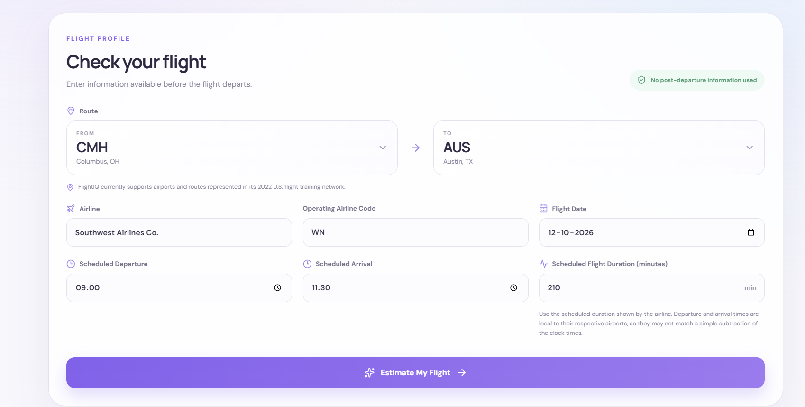
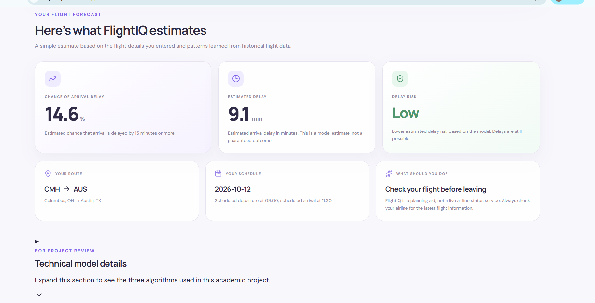

# ✈️ FlightIQ — Intelligent Flight Delay & Operational Risk Prediction System

**Predict flight delay probability. Estimate delay duration. Understand operational risk.**

FlightIQ is a machine learning-based web application that estimates the probability of a flight arriving late, predicts its expected arrival delay duration, and assigns a delay-risk category using historical flight data.

🌐 **Live Demo:** [FlightIQ Web App](https://flight-iq-six.vercel.app/)  
⚙️ **Backend API:** [FlightIQ API](https://flightiq-7i44.onrender.com)  
💻 **GitHub Repository:** [FlightIQ Source Code](https://github.com/shraddha21-prn/FlightIQ)

---

## 📸 Screenshots

### 1. Flight Input Form

Users enter their flight details to obtain a prediction.



### 2. Flight Prediction Results

The application displays the estimated delay probability, expected delay duration, and risk category.



---

## 🎯 Problem Statement

Flight delays affect passengers, airlines, airport operations, and travel planning. Understanding the possibility of a delay before a scheduled departure can help users make better-informed decisions.

FlightIQ explores how historical flight data and supervised machine learning algorithms can be used to estimate flight delay risk and expected arrival delay duration.

The project combines data analysis, machine learning, API development, and web deployment in a single application.

## 🎯 Project Objectives

- Analyze historical flight data to identify delay patterns.
- Perform data preprocessing and exploratory data analysis.
- Engineer relevant features for machine learning.
- Implement Linear Regression, Logistic Regression, and Decision Tree algorithms.
- Estimate flight delay probability and expected delay duration.
- Categorize predictions into Low, Medium, and High risk levels.
- Develop and deploy a full-stack machine learning application.
- Evaluate model performance and identify limitations.

## ✨ Key Features

- Flight details input through a web interface.
- Origin and destination airport selection.
- Airline and scheduled flight information.
- Flight arrival-delay probability estimation.
- Estimated arrival delay duration in minutes.
- Low, Medium, and High operational risk categorization.
- Trained machine learning models integrated with a Flask API.
- Interactive React frontend.
- Cloud deployment using Vercel and Render.

## 🧰 Technology Stack

| Component | Technologies |
|---|---|
| Programming languages | Python, JavaScript |
| Data processing | Pandas, NumPy |
| Machine learning | Scikit-learn |
| Data visualization | Matplotlib, Seaborn |
| Backend | Flask, Flask-CORS |
| Frontend | React, Vite |
| Model persistence | Joblib |
| Development tools | VS Code, Jupyter Notebook |
| Version control | Git, GitHub |
| Frontend deployment | Vercel |
| Backend deployment | Render |

## 📊 Dataset

The project uses the **Combined Flights 2022** dataset, derived from historical US flight data available through Kaggle.

The dataset contains information such as:

- Flight date and airline.
- Origin and destination airports.
- Scheduled departure and arrival times.
- Scheduled flight duration.
- Distance between airports.
- Actual departure and arrival information.
- Arrival and departure delay measurements.

The dataset is used for exploratory analysis, feature engineering, model training, and evaluation.

**Dataset note:** The original CSV is not included in this GitHub repository because of its large file size. Place the required dataset in the `data/` directory when reproducing the notebook workflow.

## 🧹 Data Preprocessing

The machine learning workflow includes data inspection, preprocessing, feature preparation, and model development.

Key tasks include:

- Inspecting dataset columns and data types.
- Handling missing values.
- Preparing categorical and numerical features.
- Extracting useful date and time features.
- Encoding categorical variables and applying the saved preprocessing pipeline.
- Splitting data into training and testing sets.
- Preparing classification and regression targets.

For classification, a flight is labelled delayed when its arrival delay is at least 15 minutes:

`IsDelayed = 1` when `ArrDelayMinutes >= 15`; otherwise, `IsDelayed = 0`.

The live application uses scheduled flight information rather than requiring the flight's actual arrival delay as an input.

## 📈 Exploratory Data Analysis (EDA)

The notebook investigates flight delay patterns using descriptive statistics, visualizations, and feature analysis.

Areas of analysis include:

- Delay patterns across airlines.
- Departure-hour delay rates.
- Relationships between flight duration, distance, and schedule-related features.
- Correlation analysis.
- Identification of potentially useful predictive features.

These analyses help explain the data and guide feature selection.

## 🤖 Machine Learning Algorithms

FlightIQ implements three supervised machine learning algorithms.

### 1. Linear Regression

**Purpose:** Estimate the expected arrival delay duration in minutes.

Linear Regression models the relationship between the selected flight features and the numerical delay target.

**Evaluation metrics:**
- Mean Absolute Error (MAE)
- Root Mean Squared Error (RMSE)
- Coefficient of Determination (R²)

### 2. Logistic Regression

**Purpose:** Estimate the probability that a flight will arrive at least 15 minutes late.

Logistic Regression is used as a binary classification algorithm. Its predicted probability helps communicate the likelihood of a significant arrival delay.

**Evaluation metrics:**
- Accuracy
- Precision
- Recall
- F1-score
- ROC-AUC

### 3. Decision Tree Classifier

**Purpose:** Classify a flight as delayed or not delayed.

The Decision Tree learns decision rules from the selected features and provides a second classification model for comparison.

**Evaluation metrics:**
- Accuracy
- Precision
- Recall
- F1-score
- ROC-AUC

The notebook contains the model training and evaluation workflow.

## 📏 Model Evaluation

The models are evaluated using metrics appropriate to their respective tasks.

For classification, accuracy alone is insufficient because delayed and non-delayed flights may be imbalanced. Precision, recall, F1-score, ROC-AUC, and the confusion matrix provide additional information.

For regression, MAE and RMSE measure prediction error in minutes, while R² describes the proportion of target variation explained by the model.

The project notebook records the measured results. These metrics should be interpreted carefully, and model limitations should be considered when assessing real-world usefulness.

## 🏗️ System Architecture

FlightIQ follows a frontend-backend-machine-learning architecture.

1. **User interface:** The React frontend collects scheduled flight details.
2. **API request:** The frontend sends the flight information to the Flask backend.
3. **Input validation:** The backend checks the submitted information and supported route configuration.
4. **Preprocessing:** The saved preprocessing pipeline transforms the input into the format expected by the trained models.
5. **Prediction:** The classification and regression models generate their respective estimates.
6. **Risk categorization:** The backend assigns a risk category based on the configured prediction thresholds.
7. **Results display:** The frontend displays the predicted delay probability, estimated delay duration, and risk level.

The prediction is an estimate based on historical patterns, not a guarantee of the actual flight outcome.

## 📁 Project Structure

```text
FlightIQ/
├── data/
│   └── flight_data_2022.csv
├── models/
│   ├── decision_tree.pkl
│   ├── feature_config.pkl
│   ├── linear_regression.pkl
│   ├── logistic_regression.pkl
│   └── preprocessor.pkl
├── backend/
│   ├── app.py
│   ├── requirements.txt
│   └── airport_routes.json
├── frontend/
│   ├── public/
│   ├── src/
│   ├── package.json
│   └── ...
├── screenshots/
│   ├── flightiq-input.png
│   └── flightiq-prediction.png
├── FlightIQ_ML.ipynb
├── README.md
└── .gitignore
```

*The dataset is excluded from Git, and some frontend files are omitted from this overview.*

## ⚙️ Installation and Local Setup

### Prerequisites

- Python 3.10 or a compatible Python version.
- Node.js and npm.
- Git.
- The required dataset and trained model artifacts.

### Step 1: Clone the repository

```bash
git clone https://github.com/shraddha21-prn/FlightIQ.git
cd FlightIQ
```

### Step 2: Create a Python virtual environment

On Windows PowerShell:

```powershell
python -m venv .venv
.\.venv\Scripts\Activate.ps1
```

### Step 3: Install backend dependencies

```powershell
pip install -r backend/requirements.txt
```

### Step 4: Start the backend

From the project root:

```powershell
python backend/app.py
```

The backend runs on port 5000 by default when started locally.

### Step 5: Start the frontend

Open a second terminal:

```powershell
cd frontend
npm install
npm run dev
```

Open the local development URL printed by Vite.

**Configuration note:** Ensure the frontend API base URL points to your local Flask server during local development. The deployed frontend uses the hosted Render backend.

### Step 6: Run the machine learning notebook

Open `FlightIQ_ML.ipynb` in VS Code or Jupyter Notebook.

Ensure the required dataset is present in the expected location and install the notebook dependencies before executing the cells.

## 🚀 Deployment

FlightIQ is deployed using the following services:

| Service | Platform | Link |
|---|---|---|
| Frontend | Vercel | [Open FlightIQ](https://flight-iq-six.vercel.app/) |
| Backend | Render | [Open Backend](https://flightiq-7i44.onrender.com) |
| Source code | GitHub | [View Repository](https://github.com/shraddha21-prn/FlightIQ) |

The frontend communicates with the Flask API to obtain predictions from the saved models.

## 🔮 Future Enhancements

- Improve delayed-flight recall and classification performance.
- Compare additional algorithms and tune decision thresholds.
- Validate models using chronological train/test splits.
- Add prediction explanations and feature-level insights.
- Improve API security, logging, and production server configuration.
- Evaluate performance across different routes, airlines, and time periods.
- Investigate more recent and geographically diverse flight datasets.
- Explore live data integrations if reliable data sources become available.

## ⚠️ Limitations

- The dataset is focused on US flights and does not directly represent all global or Indian flight operations.
- The system does not currently provide verified live airline status.
- Predictions depend on the historical dataset, input features, preprocessing, and model performance.
- Class imbalance can limit the detection of delayed flights.
- Predicted delay durations and risk categories are estimates and may differ from actual outcomes.

FlightIQ is an academic prototype intended to demonstrate machine learning and application deployment. It should not be used as the sole basis for real-world travel or operational decisions.

## 🎓 Academic Purpose

FlightIQ was developed as a machine learning capstone project to demonstrate:

- Data collection and understanding.
- Data cleaning and preprocessing.
- Exploratory data analysis.
- Feature engineering.
- Supervised machine learning.
- Model evaluation and comparison.
- API development.
- Full-stack integration.
- Cloud deployment.
- Technical documentation.

## 👩‍💻 Project

**FlightIQ — Intelligent Flight Delay & Operational Risk Prediction System**

Built to explore how historical flight data and machine learning can support better-informed flight delay risk estimates.

---

*Disclaimer: FlightIQ is an educational project. Predictions are not guarantees of actual flight delays and are not a substitute for official airline information.*
